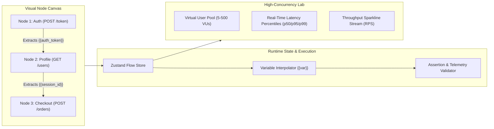

# ⚡ KINETIC — Visual Node API Workflow & Concurrency Stress Engine

> A high-performance, Linear-grade developer tool for visual API orchestration, variable chaining, and real-time load testing.


---

## 🎯 The Vision
Modern API testing tools like Postman have become bloated, sluggish electron apps loaded with unnecessary complexity. **KINETIC** is built for engineers who value speed, craftsmanship, and visual clarity:

- **Graph-Based Pipeline Orchestration**: Instead of switching between 20 tabs, construct your end-to-end authentication and checkout flows visually with draggable nodes and SVG Bezier connections.
- **Dynamic Variable Chaining**: Extract tokens, user IDs, or tracing headers from upstream responses (`body.token` ➔ `{{auth_token}}`) and automatically inject them downstream.
- **Zero-Latency Concurrency Lab**: Execute high-VU load tests directly with real-time throughput curves (RPS), percentile latency profiles (p50, p90, p95, p99), and instant Markdown export for pull requests.
- **AI Edge Fuzzer (Groq / Grok Cloud Ready)**: Generate SQLi payloads, race-condition idempotency tests, and boundary value suites with 1-click injection into your visual canvas.
- **Linear-Grade Aesthetic**: Monochromatic `#09090b` carbon surfaces, 1px subtle borders, crisp monospace telemetry, and zero AI slop.

---

## 🏗️ Architecture



---

## 🚀 Key Features

### 1. ⚡ Visual Workflow Canvas
- Smooth pan (`Middle Click` or `Drag`) and zoom (`0.4x - 2.0x`) on a minimal dot-grid canvas.
- Interactive SVG Bezier cables with live animated data packet flow during pipeline runs.
- Node statuses: `idle`, `running` (amber ping), `success` (emerald 200), and `error` (rose 500).
- One-click cable deletion and auto-port snapping.

### 2. 🔍 Right-Side Node Inspector
- **Header & Query Param Editor**: Key-value pairs with toggle switches and variable injection.
- **JSON Payload Editor**: Formatted code view supporting runtime variables (`{{session_id}}`).
- **Variable Extractor**: Extract any JSON path from response headers or bodies into global pipeline variables.
- **Response Assertions**: Define automated tests (`status == 200`, `latency < 500ms`, `body contains 'success'`).
- **Raw Telemetry**: Latency waterfall in milliseconds, payload size in bytes, and formatted JSON viewer with 1-click clipboard copy.

### 3. 📊 Concurrency & Stress Testing Lab
- Configurable Virtual Users (up to 250+ VUs) and duration timers.
- Live streaming **Throughput / RPS charts** and **Latency Percentile Waterfall** using Recharts.
- Success / Error rate telemetry with automated Markdown performance report generation.

### 4. 🤖 AI Edge Fuzzer & Pentest Suite
- Built-in adversarial presets:
  - **SQLi & Header Injection**: Tests for authentication bypass and path null-bytes.
  - **Buffer & Float Underflows**: Massive payload recursion and negative quantities.
  - **Race Condition Attacks**: Idempotency token replays.
- 1-click "Inject Nodes into Canvas" to immediately test your endpoints against real-world vulnerabilities.

### 5. 💻 cURL Importer
- Paste any `curl` command from Chrome DevTools, terminal, or API docs.
- Automatically parses method, URL, headers, and body into a ready-to-execute canvas node.

---

## ⌨️ Keyboard Shortcuts

| Shortcut | Action |
|---|---|
| `⌘ + Enter` / `Ctrl + Enter` | Run Entire Pipeline |
| `Esc` | Deselect Node / Close Inspector & Modals |
| `Space + Drag` / `Middle Click` | Pan Canvas |
| `Scroll Wheel` | Zoom In / Out |

---

## 🛠️ Quick Start

```bash
# Navigate to project directory
cd kinetic

# Install dependencies
npm install

# Run the development server
npm run dev
```

Open [http://localhost:3000](http://localhost:3000) in your browser.

---

## 🏆 Built with Pride & Craft
Engineered with Next.js 14, React 18, TypeScript, Tailwind CSS, Framer Motion, Recharts, and Zustand.
